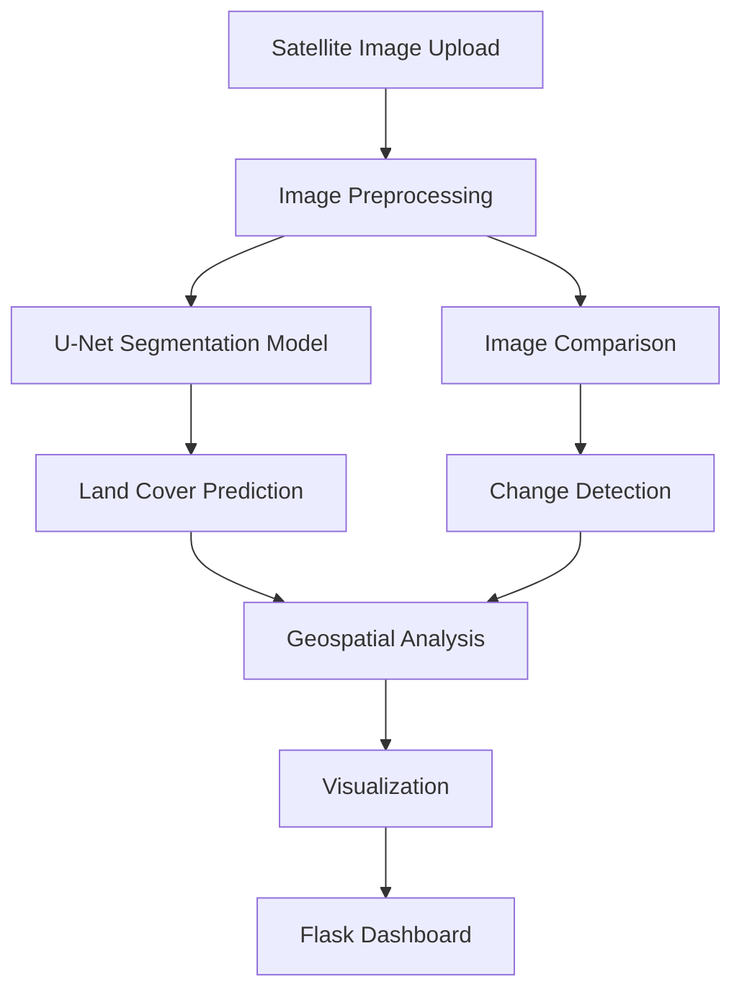

# System Architecture

## 1. Overview

The AI Satellite Intelligence System uses computer vision, deep learning, and geospatial processing to analyze satellite imagery.

## 2. Architecture Diagram

## 3. Main Components

### Data Input
Accepts satellite images in supported image formats, including GeoTIFF.

### Preprocessing
Resizes and normalizes satellite images before model inference.

### Segmentation
Uses a U-Net convolutional neural network to predict land-cover classes.

### Change Detection
Compares two images to identify pixel-level differences. Reliable results require spatially aligned imagery.

### Geospatial Processing
Reads coordinate reference systems and raster metadata to support geographic calculations.

### Visualization
Creates colored segmentation masks and image overlays.

### Web Dashboard
Uses Flask to provide an interface for uploading images and viewing analysis results.

## 4. Technology Stack

- Python
- PyTorch
- OpenCV
- Rasterio
- GeoPandas
- NumPy
- Flask
- HTML, CSS, JavaScript

## 5. Current Limitations

- A trained model checkpoint is not included yet.
- Prediction quality depends on the training dataset.
- Pixel-level image differences are not equivalent to validated land-cover change.
- Geospatial accuracy depends on image alignment and coordinate reference systems.
