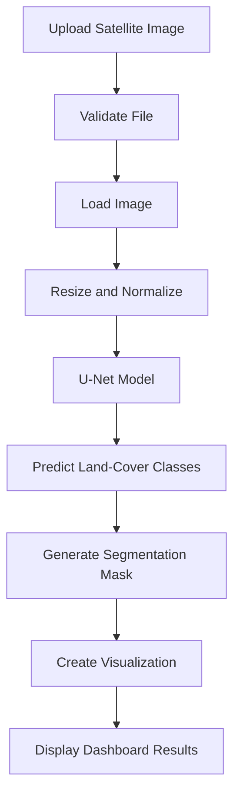
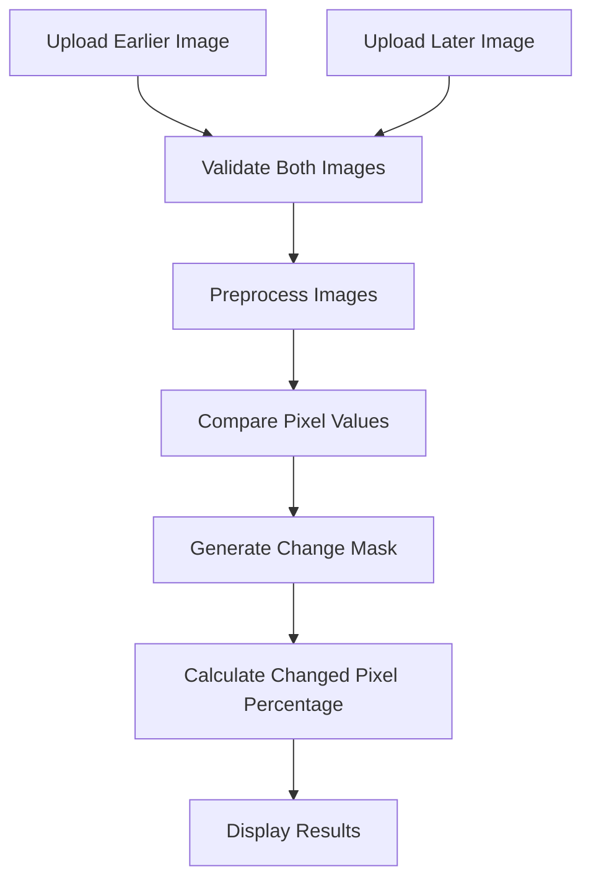

# AI Satellite Intelligence Workflow

## 1. System Overview

The system processes satellite imagery through a sequence of image-processing, deep-learning, and visualization stages.

## 2. Segmentation Workflow

## 3. Change Detection Workflow

**Important:** The current change-detection method is a pixel-difference baseline. Accurate real-world analysis requires co-registered imagery and suitable radiometric preprocessing.

## 4. Geospatial Workflow

1. Read GeoTIFF metadata.
2. Inspect the coordinate reference system.
3. Read raster dimensions and geographic transform.
4. Calculate pixel area when the CRS supports valid metric measurements.
5. Extract geographic features from masks.

## 5. Output Types

The system is designed to produce:

- Segmentation masks
- Colored land-cover visualizations
- Image overlays
- Pixel-level change masks
- Change percentages
- Geospatial summaries

## 6. Quality Assurance

Before trusting any output:

- Check image quality.
- Verify image alignment.
- Confirm model checkpoint compatibility.
- Inspect segmentation masks.
- Validate geospatial metadata.
- Compare predictions against independent reference data.

## 7. Current Development Status

The application and core processing modules have been created. Dataset preparation, compatible model training, and complete end-to-end validation are still required.
